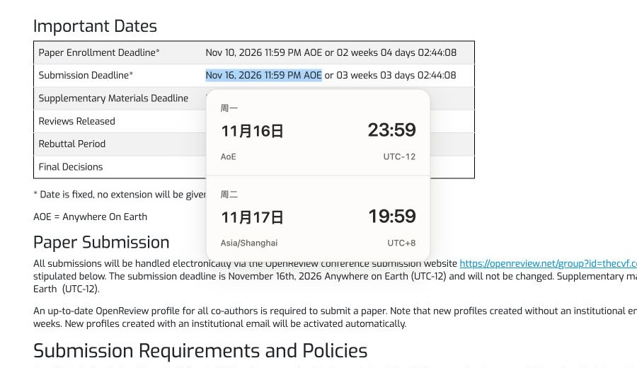
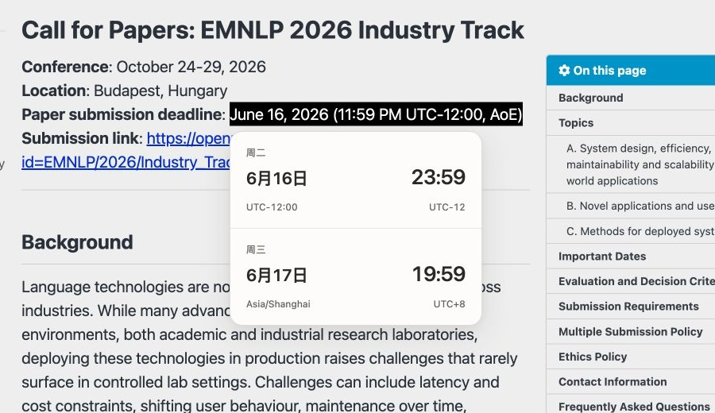
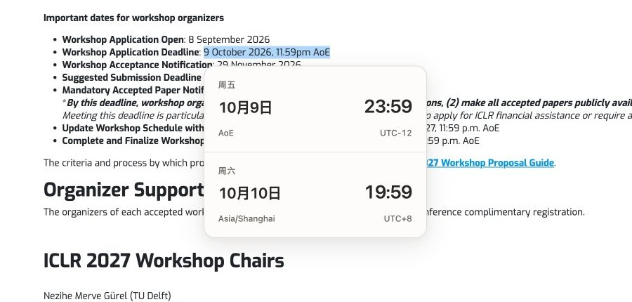
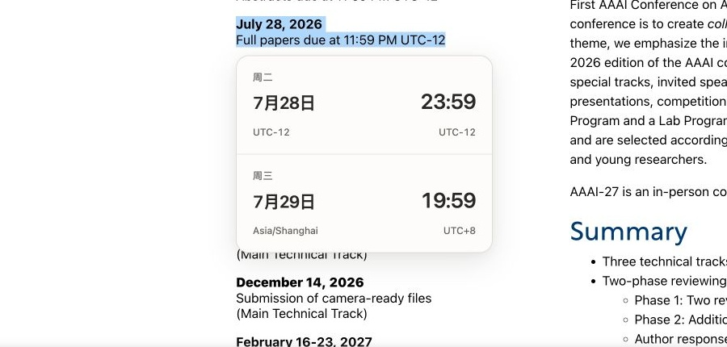
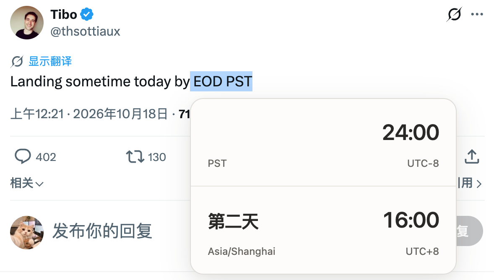
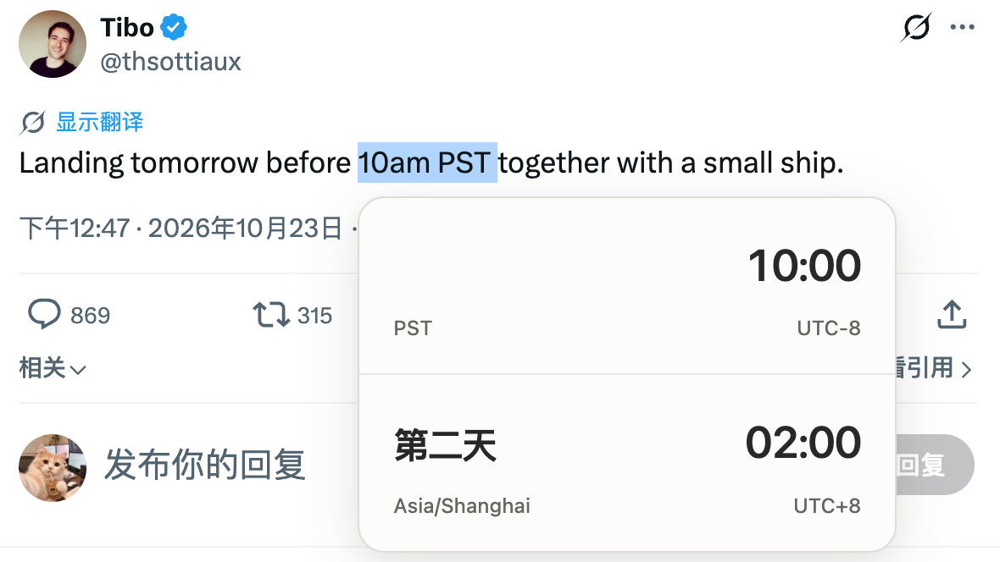
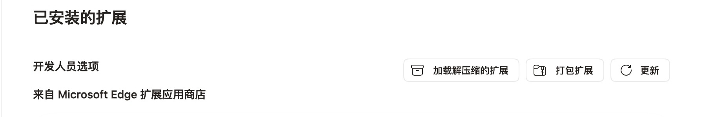
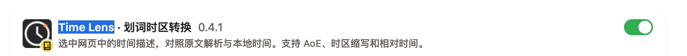
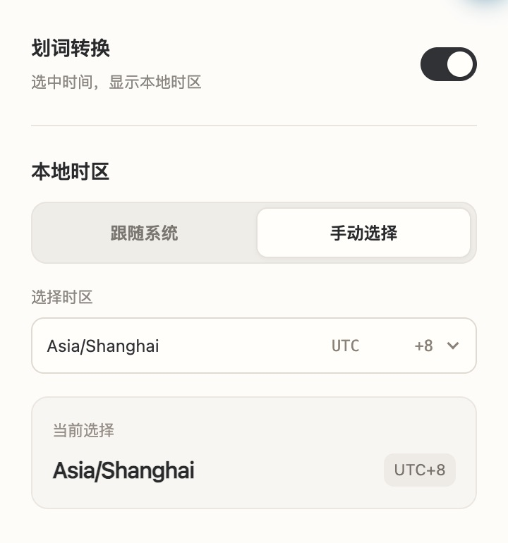

<h1 align="center">Time Lens（Chrome 浏览器插件）</h1>

## Examples

### 会议截止时间

<table>
  <tr>
    <td align="center" valign="top" width="50%">
       
      <strong>CVPR 2027 · 主会全文投稿</strong> 
      <code>2026-11-16 23:59 AoE</code> <code>→ 2026-11-17 19:59</code> 
      <a href="https://cvpr.thecvf.com/Conferences/2027/CallForPapers">官网原页</a>
    </td>
    <td align="center" valign="top" width="50%">
       
      <strong>EMNLP 2026 · Industry Track 投稿</strong> 
      <code>2026-06-16 23:59 UTC−12</code> <code>→ 2026-06-17 19:59</code> 
      <a href="https://2026.emnlp.org/calls/industry_track/">官网原页</a>
    </td>
  </tr>
  <tr>
    <td align="center" valign="top" width="50%">
       
      <strong>ICLR 2027 · Workshop 申请</strong> 
      <code>2026-10-09 23:59 AoE</code> <code>→ 2026-10-10 19:59</code> 
      <a href="https://iclr.cc/Conferences/2027/CallForWorkshops">官网原页</a>
    </td>
    <td align="center" valign="top" width="50%">
       
      <strong>AAAI-27 · 主会全文投稿</strong> 
      <code>2026-07-28 23:59 UTC−12</code> <code>→ 2026-07-29 19:59</code> 
      <a href="https://aaai.org/conference/aaai/aaai-27/main-technical-track-call/">官网原页</a>
    </td>
  </tr>
</table>

### 推文里的相对时间

只划选 `EOD PST` 或 `10am PST` 时，选区没有完整事件日期。浮窗给出“第二天”与本地时刻，不把帖子的发布时间或选区外的 `today` / `tomorrow` 猜成事件日期。

<table>
  <tr>
    <td align="center" valign="top" width="50%">
       
      <strong>EOD PST</strong> 
      <code>24:00 → 第二天 16:00</code> 
      <a href="https://x.com/thsottiaux/status/2111492738025959922">X 原帖</a>
    </td>
    <td align="center" valign="top" width="50%">
       
      <strong>10am PST</strong> 
      <code>10:00 → 第二天 02:00</code> 
      <a href="https://x.com/thsottiaux/status/2113492502355562875">X 原帖</a>
    </td>
  </tr>
</table>

## 安装

1. [下载源码 ZIP](https://github.com/caopulan/time-lens/archive/refs/heads/main.zip)，解压到一个固定目录。
2. 在 Chrome 打开 `chrome://extensions/`，或在 Edge 打开 `edge://extensions/`，启用开发者模式。
3. 点击“加载已解压的扩展程序”，选择包含 `manifest.json` 的目录。
4. 打开普通 HTTP/HTTPS 网页，选中一个带明确时区的时间表达，例如 `Nov 16, 2026 11:59 PM AOE`。

浏览器内部页面、扩展商店和内置 PDF 查看器受限制；本版本也不匹配本地 `file://` 页面。站点权限设为“点击时”时，需先允许扩展访问该站点。

## 设置

点击工具栏中的 Time Lens 图标打开设置。修改后自动保存。

- **划词转换**：启用或暂停。关闭时，已经打开的划词浮窗也会收起。
- **本地时区**：首次默认“跟随系统”，通过浏览器的 `Intl.DateTimeFormat().resolvedOptions().timeZone` 获取系统时区，无需定位权限。切到“手动选择”后，下拉列表列出浏览器提供的全部主要 IANA 时区，以及 `UTC`、有效的系统时区和已保存的时区别名。时区名称靠左；当前 UTC 偏移放在右侧的固定宽度列中。每行的 `UTC` 前缀从同一位置开始，后面的数值靠右对齐。长名称不会把 UTC 列挤开。选择后立即保存。

跟随系统时保存的是自动模式，不会把当前系统时区固定下来。系统时区改变后，下次划词或返回已有浮窗时会重新读取；手动选择的时区则保持固定。升级会保留已有启用状态和已保存的手动时区。

下拉列表使用 `Intl.supportedValuesOf('timeZone')`，列表不会被当前选项的文字过滤成单个结果。具体名称及数量由浏览器的时区数据库决定，不把所有历史别名重复列出；有效的旧设置仍会保留在列表中。若浏览器缺少完整时区列表接口，面板会显示兼容性提示。

展开列表后可滚动或使用方向键、Home／End 导航；Enter／空格确认，Escape 收起并取消当前高亮，Tab 保持正常焦点顺序。键盘移动高亮不会保存设置，确认选择后才保存。

面板显示的是该时区**当前**的 UTC 偏移，重新聚焦设置窗口时刷新；带日期的实际时间换算仍根据事件日期处理夏令时。无效时区不会保存；写入失败会显示错误。

## 更新

- **0.4.1 · 2026-10-24**：手动时区列表将名称和 UTC 偏移分列显示，整点、半小时和四分之一小时的偏移对齐；保留完整列表、键盘操作和自动保存。
- **0.4.0 · 2026-10-24**：加入无日期时钟的相对跨日换算和完整时区选择；修正月份、星期、UTC 偏移、跨年及跨国际日期变更线的计算。

## 日期与缺失信息的规则

- **明确日期 + 明确时刻**：进行准确的时区转换。
- **只有日期**：表示该来源时区的一整天，换到目标时区后可能覆盖两个日期，显示日期范围；两块都不显示时钟。不能把“日期”自行当成唯一截止时刻。
- **缺少年份**：界面隐藏年份，但星期和时区换算仍需要内部的完整日期。只有同一条内容存在可靠的机器可读发布时间时，才用该内容在来源时区的年份补充。不会从整个时间线取别的帖子时间，也不默认使用电脑当前年份。
- **只有 `10am PST` 等时钟而没有日期**：仍然转换。来源日期留空；转换日期以“前一天／当天／第二天”等表示，不显示星期。`PST`、`PDT` 和明确 UTC 偏移按其固定值计算；`PT` / IANA 时区的夏令时规则以**来源时区的今天**为内部参照。推文发布日期不会被当成事件日期。缺少日期时无法确定未来或历史的夏令时规则；若要换算指定日，请一并选中日期。
- **选区外的 `tomorrow`**：本次不扩展上下文读取。若选区本身包含 `today` / `tomorrow`，仅在同一条内容有可靠发布时间时解析。
- **CST / IST / BST 等全球有歧义的缩写**：要求改用明确 UTC 偏移或 IANA 时区，不擅自选择地区。
- **before / by / around**：显示被转换的界限时刻，不代表实际执行时间。`EOD` 的边界用来源日 `24:00` 表示。
- 一个选区含多个不同时间、多个日期或夏令时重复时刻时，不显示单一猜测结果。

只有时间时也仍需明确来源时区。例如 `10am PST` 可以换算，单独的 `10am` 无法确定它属于哪个时区。

## 只有时间的示例

| 选中文字 | 目标时区 | 来源日期 / 时间 | 转换日期 / 时间 |
| --- | --- | --- | --- |
| `10am PST` | `Asia/Shanghai` | 空白 / `10:00` | 第二天 / `02:00` |
| `09:15 UTC+8` | `UTC` | 空白 / `09:15` | 当天 / `01:15` |
| `00:30 UTC+8` | `UTC` | 空白 / `00:30` | 前一天 / `16:30` |

表中的“空白”仅用于说明，实际浮窗不会写出“空白”或其他占位文字。

## 验证与隐私

使用 Node.js 22.22.2、24.15.0 或更新的受支持版本，运行 `npm ci && npm test` 可执行解析、浮窗和设置回归测试。单独运行 `node tests.js` 无需第三方依赖。`ui-tests.cjs` 使用 jsdom 检查两块 DOM、事件与系统时区变化，`settings-tests.cjs` 检查设置加载、自动保存、模式切换和错误处理。具备 Playwright Chromium 的本地环境还可运行 `npm run test:browser` 验证扩展注入；首次运行前执行 `npx playwright install chromium`。

0.4.1 已通过 207 项解析、20 项浮窗 DOM／事件和 27 项设置回归测试，覆盖跨日标签、时区偏移、保存顺序与键盘操作。Playwright Chromium 还验证了扩展注入、时间字段、内容安全策略和上下两块的计算样式；未进行像素级验收。附带的 `test.html` 提供可选中的自测样本。

扩展运行时完全离线，不上传选区、网页或推文。

## 许可证

项目代码与原创文档采用 [MIT](LICENSE) 许可，© 2026 Pu Cao。截图中的第三方网页和帖子内容归原权利人所有。
